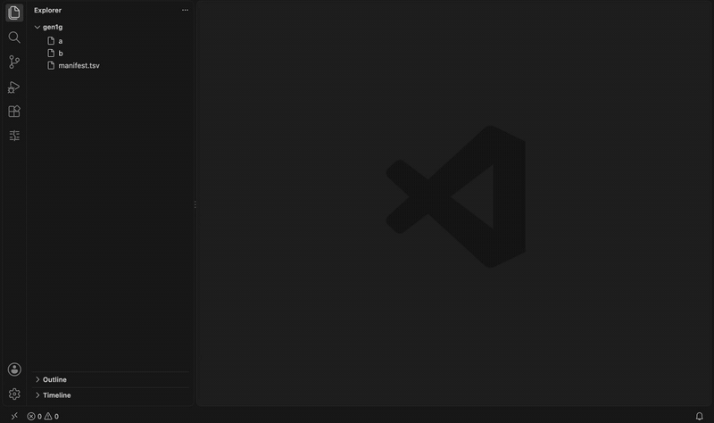

# Rift for VS Code

Compare two large text files without opening them in an editor. The Rift
side panel lists the differing segments and the moved blocks. Selecting one
opens VS Code's own diff editor on just that excerpt, so the native diff UI
works on files far beyond what VS Code can load.

The recording is a generated 1 GiB pair on an Apple M1. A
[higher-quality MP4](media/rift-demo.mp4) and the
[poster frame](media/rift-demo-poster.png) are in the repository.

## Use

Select two files in the Explorer and choose **Compare with Rift**, or run
**Rift: Compare Files…** from the command palette.

The **Rift** view in the activity bar shows:

- a summary row: line counts, segments by status, moved blocks;
- the differing segments with their line ranges in both files, loaded 100
  at a time ("Load more…" at the end of a page). Segments whose result is
  approximate are marked;
- the moved blocks, each with both ends.

Selecting a segment or a moved block opens a diff of that excerpt with the
context lines around it. The tab title carries the original line ranges,
for example `a.sql 1,204,880–1,204,940 ↔ b.sql 1,204,877–1,204,941`. The
documents are read-only and hold only the excerpt, never the whole file.
Very long lines are cut and marked; bytes that are not valid UTF-8 are shown
lossily and flagged.

A scan of a large pair takes a while. The view and the status bar show its
progress, and the tree fills in when the scan ends.

## Settings

| Setting | Default | Meaning |
|---|---|---|
| `rift.path` | empty | `rift` binary to run. Empty uses the binary bundled with the extension. |
| `rift.mem` | `256M` | Heap budget of one comparison, as for `rift --mem` (`64M`, `1G`, `300K`, bytes). The server refuses a value over its own limit of 1G per comparison. |
| `rift.contextLines` | `3` | Lines of context around a difference, 0 to 100. |

If a scan does not fit its budget, the error offers to rerun with the
server's advice plus 25%, rounded up to the next power of two from 16M
(16M, 32M, 64M, … 1G, 2G) and capped at the server's per-comparison limit.
When the cap leaves no room above the budget that just failed, no rerun is
offered. A pair that is refused twice more gets a link to the
[memory guide](https://rubtsov-stan.github.io/rift/guide/memory/) instead of a
third button.

## Commands and keys

| Command | Key |
|---|---|
| Rift: Compare Files… | |
| Compare with Rift (Explorer, two files selected) | |
| Rift: Next Difference | `Ctrl+Alt+N` |
| Rift: Previous Difference | `Ctrl+Alt+P` |
| Rift: Go to Line in File A… | `Ctrl+Alt+G` |
| Rift: Close Comparison | |

The keys apply while a comparison is open. `Ctrl` is the Control key on
macOS too.

## Requirements

The extension for darwin-arm64, darwin-x64, linux-x64 and linux-arm64 bundles
the matching `rift` binary, so there is nothing to install. On another
platform, install `rift` yourself and set `rift.path`. Windows is not
supported.

## Privacy

Everything stays on your machine. The extension starts one `rift serve`
process per window and talks to it over standard input and output. It makes
no network connections and sends no telemetry. The files you compare are
read by that process only, in fixed-size blocks, and are never copied.

## Status

Not yet published to the Visual Studio Marketplace or Open VSX. The source
is in [the Rift repository](https://github.com/rubtsov-stan/rift/tree/main/editors/vscode).

Licensed under MIT or Apache 2.0, at your option.
